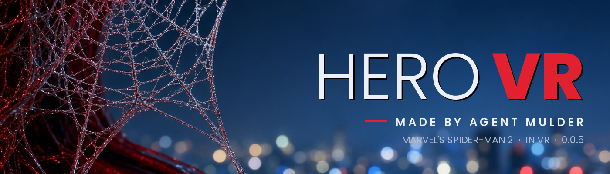
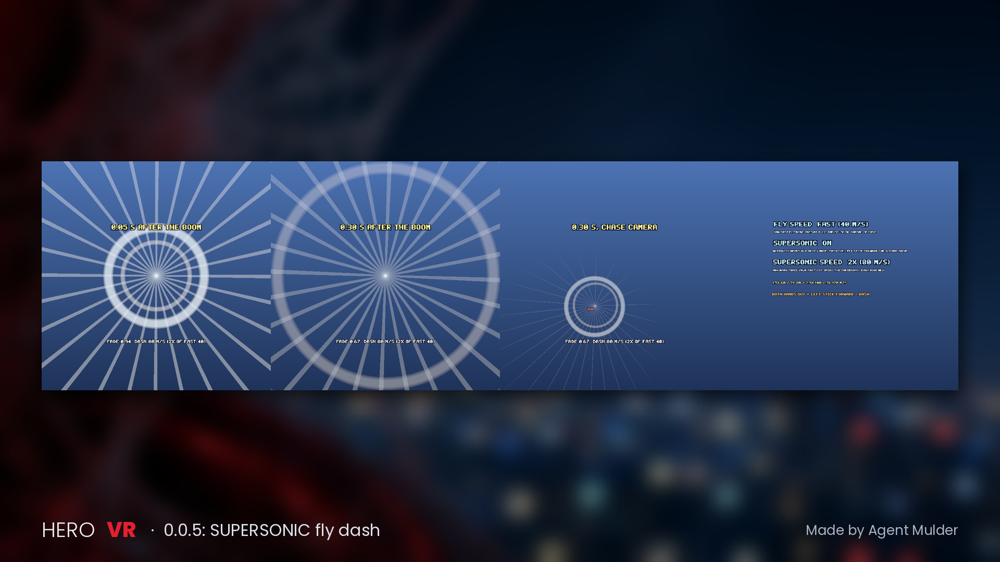

# HERO VR - Made by Agent Mulder

HERO VR is a free, unofficial VR mod for **Marvel's Spider-Man 2** on PC. It is a port of
**Spidy (SpidyVR) by Ilya Mezerowsky** (https://github.com/IlyaMez/SpidyVR), and it comes with the HERO VR launcher:
one window with a big **PLAY VR** button, launch options, build, updates, revert and reports.

This repository is the full source of mod Version 0.0.6 (build Update 39.1) and of the HERO VR launcher (`tools/launcher`).
**Download:** the zip `HERO-VR-Launcher-0.0.6.zip` on the [Releases](../../releases) page (source plus the prebuilt launcher).

## Features
- Marvel's Spider-Man 2 in stereo VR through OpenXR (Virtual Desktop, Quest Link / Air Link, SteamVR).
- The HERO VR launcher: PLAY VR, launch options, build, updates, revert and reports in one window.
- The wrist hologram settings menu, FLY mode, punches, Iron Man repulsors and beam, hero height.
- Changes nothing in the game folder; everything is put back when VR stops.

## What's new in 0.0.6
- Hero powers that do real damage: IRON MAN (repulsors and the chest beam, aimed at the enemy you look at),
  DAREDEVIL (a baton in each hand that chains to up to 3 more enemies, harder punches, a sonar look) and
  HULK (a 4x charged jump, one-punch knockouts on normal enemies). One hero at a time, all OFF by default, all live.
- A new Iron Man repulsor: palm charge, a white-hot bolt with a blue falloff, an impact burst and a new sound.
- An 8-page hologram (STATUS, POWERS, VR SETTINGS, COMBAT, GRAPHICS, COLOR, CONTROLS, MUSIC) with named sections.
- Opt-in reports: crash reports and Report a bug open a filled-in GitHub issue you can read first; play stats are off
  unless you turn them on. Nothing is ever sent by itself.
- Frame rate help: the session advice says whether the graphics card is the limit and suggests 72/80 Hz and
  RenderScale 90/80 (about +14% / +30% frames, estimates); AUTO PERFORMANCE (off by default) aims at half rate when
  full rate is out of reach. The graphics defaults are unchanged.
- VR no longer ends when the headset is lost: the mod waits for it and brings VR back by itself.
- Launcher build 6: **Revert > USE PREVIOUS VERSION (0.0.5)** goes back to 0.0.5 in one click (downloaded from the
  v0.0.5 release and SHA-256 checked); the launcher then stays on 0.0.5 until **Updates > Update now**.

## Requirements
- Windows 10 or 11 (64-bit).
- Marvel's Spider-Man 2 on Steam, **version 2.810.0.0** (Spider-Man2.exe). Other versions are refused on purpose.
- A PC VR headset and its OpenXR app: Virtual Desktop (tested with Quest 3), Quest Link / Air Link or SteamVR.
- **Python 3.11+** from python.org, with "Add python.exe to PATH" ticked (it runs the mod's live settings).
- An internet connection on the first run. You don't need Visual Studio or Git: nothing is compiled on your PC.

## Install
1. Download `HERO-VR-Launcher-0.0.6.zip` from Releases. Right-click the zip, choose **Extract All...**, and extract it to a short path you can write to, for example
   `C:\HERO-VR`. Don't use Program Files or a OneDrive folder.
2. Double-click **HERO VR Launcher.cmd**. If SmartScreen warns you, click **More info** and then **Run anyway**.
   The launcher is unsigned.
3. On the first run the launcher downloads the ready-made mod files from the release and checks their SHA-256.
   If that was interrupted, press **Repair** on **Status** (or just PLAY VR, which offers it).
4. Start your VR app, put the headset on and press **PLAY VR**. The default launch options are:
   `-RenderScale 100 -OverlayWebs -EngineTaa -SmallerDesktopView`.

Already on 0.0.5? The launcher offers 0.0.6 by itself (or **Updates > Update now**). To go back, use
**Revert > USE PREVIOUS VERSION (0.0.5)**. To build the mod yourself, run `tools\build.ps1 -Observer -FromSource`
(Visual Studio 2022/2026 with C++, Git for Windows, Python 3.11+).

To get the wrist hologram (the settings menu) in VR, bring your right hand to your left forearm and pull the right trigger. On the keyboard, press F8.
If something goes wrong, open **Reports** in the launcher, or send the newest `reports\game-vr-*.json` and `-console.log`.

## Credits
- **Spidy (SpidyVR) by Ilya Mezerowsky**: the VR mod this is built on. https://github.com/IlyaMez/SpidyVR,
  support: https://ko-fi.com/ilyamezerowsky
- SpidyVR contributors:
  - Sebi (sjrl2000), Linux guide, PR 7;
  - iplusdvr, PRs 21, 22 and 23;
  - Adrian (AdrianGzzEsc), PR 24.
- Swinging inspiration: Blaze's Spider-Man for Blade & Sorcery, by Blazeventura and ANTIOPSVR. None of its code is used.
- Game addresses: SM2VR 0.0.27.
- Third-party software is listed in THIRD_PARTY_NOTICES.md: OpenXR SDK, JsonCpp, MinHook, Dear ImGui, fonts, bHaptics SDK and Python.
- The HERO VR port and launcher are by Agent Mulder. TikTok: https://www.tiktok.com/@agentmulder, Discord: https://discord.gg/W2b9YjRXzf

## License
HERO VR is free software under the **GNU General Public License version 3**. See LICENSE.
This repository and the release zip are the complete source; see SOURCE.txt in the zip. The original Spidy README is kept as [SPIDY-ORIGINAL-README.md](SPIDY-ORIGINAL-README.md). You may share and change it under the GPLv3.

Not affiliated with or endorsed by Insomniac Games, Sony Interactive Entertainment, Marvel or Valve.
"Marvel's Spider-Man 2" is used only to say which game this mod is for, and it is a trademark of its owners.
