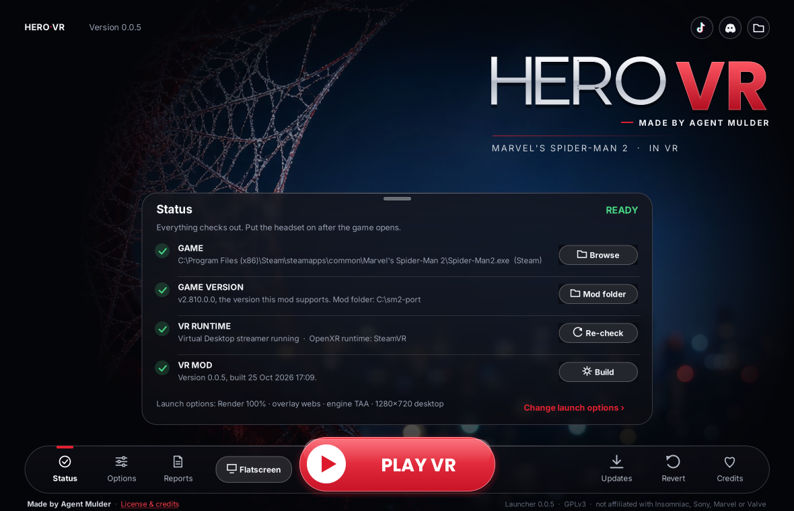

# HERO VR Launcher

HERO VR is a one-window Windows launcher for the Marvel's Spider-Man 2 VR port. It has one big **PLAY VR** button, the launch
options as toggles and sliders, and pages for build, update, revert, reports and credits. It sits over the red and silver web on the
night city background.



**HERO VR by Agent Mulder** ([TikTok @agentmulder](https://www.tiktok.com/@agentmulder) · [Discord](https://discord.gg/W2b9YjRXzf)).
*Built on Spidy by Ilya Mezerowsky* (SpidyVR, GPLv3). See the launcher's Credits page and [NOTICE](NOTICE).

Launcher version **0.0.74.1** (launcher build 15), shipped with HERO VR 0.0.74 (mod Version 0.0.74, build Update 39.7).

Build 15 ships with mod Version 0.0.74 (still EXPERIMENTAL, 0.0.63 the most recent STABLE build): Revert offers 0.0.73 first, then 0.0.63, 0.0.62, 0.0.6 and 0.0.5; the internet server list (the free Cloudflare lobby), safety checks and the newest crash dump in Reports come with it.

Build 14 makes SMOOTH TURN (120 °/s) the default, makes the classic design the default again (anyone on the new design moves to classic once; the new design stays a switch in Options > Launcher), adds KEEP MY GAME AA, and credits WOLVERINE's claws on the Credits page. It keeps the EXPERIMENTAL update confirm (0.0.63 is the most recent STABLE build) and Revert to 0.0.63, 0.0.62, 0.0.6 and 0.0.5.

Build 13 credits the 0.0.72 models, the 23 worn suits and the ROSTER pictures on the Credits page. It keeps build 12's EXPERIMENTAL update confirm (0.0.63 is the most recent STABLE build) and Revert to 0.0.63, 0.0.62, 0.0.6 and 0.0.5.

Build 12 fixes VR not starting after Stop VR ("handle is invalid" at finding the headset): PowerShell gets its own standard input and Stop VR keeps the launcher's own standard handles. Everything else is build 11 (0.0.70).

Build 11 makes the optional HERO VR design smoother (the orb and the lag fixes) and adds 0.0.63 to Revert (USE 0.0.63, 0.0.62, 0.0.6 or 0.0.5). The classic design stays the default: the launcher asks once whether to restart with the new design, Options > Launcher design switches between the two at any time, and the launcher opens the classic design by itself if the new one fails to start. Hold Shift while starting it, or start it with `--classic`, to open the classic design.

## Multiplayer (same network)

The **Multiplayer** sheet (header button; "Multiplayer" link on the new design's home) hosts or joins a friend's game on the same
network with no IP typing: **Host** announces this PC, the list shows games heard on the network (name, hero, players), **Join**
picks one, **Leave** stops. It writes `%APPDATA%\Spidy\MP-LOBBY.txt` for the game; the game's `MP-PEER.txt` stays the advanced
fallback for VPNs. **Allow through firewall** adds one inbound rule for UDP 39469-39474 (Private + Public networks, 0.0.74 MP INTERNET). See
[docs/MP-SOLO-TEST.md](../../docs/MP-SOLO-TEST.md).

## Multiplayer over the internet (0.0.74 MP INTERNET)

- The window opens on the server list: LAN and internet games together, and Join with one click.
- At first start, the "No" / "Yes, Autosetup" pop-up adds the firewall rule with one admin prompt (`Autosetup.cs`).
  It can also download a runtime, checked against its SHA-256 before running; none is needed today.
- The server address is `InternetLobby.DefaultUrl`: the free Cloudflare Worker `https://herovr-lobby.herovr.workers.dev`.
  A JOIN that gets no answer in 30 s shows one line ("Could not connect to ... Press JOIN to try again"). `SM2VR_LOBBY_URL` or the setting `LobbyUrl` override it,
  but only for https:// or a localhost http:// address. Setup: docs/LOBBY-OWNER-SETUP.md.

## Privacy and reports

There is no tracking and no account. Multiplayer's internet server list runs on HERO VR's own free Cloudflare
server (`https://herovr-lobby.herovr.workers.dev`): the list shows only game names, heroes and player counts, never an
address. A host's address goes only to the player who presses JOIN (and that player's only to that host). Reports
never go through it or any other server of ours: every report opens a pre-filled issue on the mod's GitHub page ([lecutis7of9/HEROVR](https://github.com/lecutis7of9/HEROVR/issues))
in your browser, where you can read and edit all of it, and nothing is sent until **you** press *Submit* (a free
GitHub account is needed for that). Close the page and nothing is sent.

* **Crash reports** (on by default, Options > Privacy > *Offer crash reports*). If the game or the launcher crashed,
  or a VR session did not end cleanly, the next start asks *"Send this crash report to help fix it?"* with
  **Send report**, **Not now** and **Don't ask again**. It is asked once per crash.
* **Report a bug** (Reports). Type a short description; tick or untick the system info (Windows version, graphics
  card, VR runtime name).
* **Play stats** (off by default, asked once at first start, Options > Privacy > *Share play stats*). When on, the
  launcher keeps a short summary of your last 10 VR sessions on your PC, and **Send play stats** in Reports shares
  them in one click: mod version, minutes played, game fps (average and low), VR frame rate, stalls, the hero and
  which features were on, render scale, graphics card and headset/runtime name. Turning it off deletes what was kept.
  Neither setting needs a restart of the game or the launcher.

What is never included: your name, Windows user name or PC name, folder paths (`C:\Users\<you>\...` becomes
`<user>`), e-mail addresses, IP addresses, Steam IDs, save data or files. Reports are plain text you can see before
sending. **Collect reports** is separate and older: it zips `reports\` for you to attach yourself, and those log
files can contain folder paths with your Windows user name, so look before you share it.

## Where it lives
The prebuilt exe is `tools\launcher\SM2VRLauncher.exe`, and **HERO VR Launcher.cmd** in the install's top folder starts it.
A launcher inside an install always manages that install. It finds the install by walking up to `tools\launch-game-vr.ps1`.

## Build it yourself (Windows, nothing to install)
```powershell
powershell -ExecutionPolicy Bypass -File tools\launcher\build.ps1
```
This compiles `src\*.cs` with the C# compiler that ships with Windows (.NET Framework 4.8) into `tools\launcher\out\SM2VRLauncher.exe`.
`-Preview` starts it with sample data, so no game is needed.
On Linux or macOS, `sh build.sh` makes a test build with Mono.

## Settings
- Your settings are saved in `%APPDATA%\SM2 VR Launcher\settings.ini`. The folder keeps its internal name so that settings from earlier
  builds still work.
- `launcher.ini` beside the exe sets these defaults (see `launcher.ini.example`):
  - `UpdateRepo=owner/repo` is the GitHub repository whose Releases carry `version.json`;
  - `CheckOnStart`;
  - `PortRoot`;
  - `Portable`.
- The release manifest is made by `tools/make_version_json.py` (or `tools/make-version-json.ps1`). See PUBLISHING.md.

Internal names are kept on purpose: `SM2VRLauncher.exe`, `%APPDATA%\SM2 VR Launcher`, the `SM2VR-Launcher/` user agent, the
`sm2-vr-*.zip` asset names and the `SM2 VR` manifest name. Only the names you see on screen say HERO VR.

## License
GNU GPL version 3 (LICENSE at the top of the install). Not affiliated with Insomniac Games, Sony Interactive Entertainment, Marvel or Valve.
